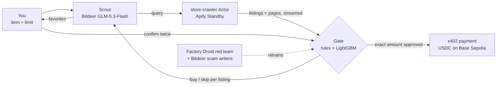

  

<b>The shopping agent that doesn't compromise on speed or safety.</b>

<em>The AI finds the deal. Code holds the wallet.</em>

  <b>Try the agent:</b> <a href="https://hntr.store">hntr.store</a>
  &nbsp;·&nbsp; <b>Live stores:</b> <a href="https://amazon.hntr.store">mzn</a>, <a href="https://ebay.hntr.store">by</a>, <a href="https://depop.hntr.store">dpp</a>, and the scam lookalike <a href="https://amazon-outlet.hntr.store">mzn Official Outlet</a>

  <a href="#the-problem">Problem</a> ·
  <a href="#our-value">Value</a> ·
  <a href="#approach-at-a-glance">Approach</a> ·
  <a href="#results">Results</a> ·
  <a href="#built-with">Built with</a> ·
  <a href="#technical-reference">Technical reference</a>

# The problem

AI can already find good prices, but **only about 1 in 10 people will let an agent finish a purchase**. Trust breaks
down between finding an item and paying for it, and the bigger the amount, the worse it gets.

That fear is reasonable. Studies from Guardio, Microsoft + ASU, F-Secure and Unit 42 show agents buying from fake
stores, paying scammers after reading fake reviews, leaking user data, and getting hijacked by hidden text in a
listing. Agentic payment rails (Visa, Mastercard, Coinbase x402) already exist, and projections put AI-driven US sales
at $300-500B by 2030. What's missing is a reason to trust the agent with the money.

# Our value

**Hunter is reimagining the shopping experience: you hand a purchase to an AI without handing it your wallet.** You
say what you want and set a limit once. Hunter searches real marketplaces, asks only the questions that change which
listings fit, and shows you its favorites. Shopping with an agent should be both fast and safe, and Hunter doesn't
trade one for the other.

- **Speed.** Today's marketplaces are built for people, with logins, carts and checkout forms an agent has to fight
  through. So we rebuilt three of them for agents: **we scraped 2,000+ real product listings across Amazon, eBay and
  Depop with Apify** and serve them from our own storefronts (mzn, by, dpp). Each publishes its catalog and wallet in machine-readable form
  and sells through **x402**, so an agent reads listings directly and pays over plain HTTP, with no account and no
  checkout form. Hunter searches every store at once and streams results as they arrive: the first listing comes back
  in well under a second, each listing gets its safety verdict 0.2-0.3 s after its page loads, and a full search and
  screening finishes in 5-12 s. Safety checks run while the search streams, so they add almost no wait.
- **Security.** The language model never touches the money. It reads listings, so a scam listing can talk to it, and
  that's exactly why it gets no say over payment. A payment **Gate** screens every listing as it streams in and checks
  the chosen one again before any money moves: deterministic code checks the store, the seller's wallet, the price and your limit, then
  signs an x402 payment for exactly the confirmed amount. A prompt injection in a listing can change what the model
  says. It can't change what the Gate approves.

**The Gate is only as good as the scams it has faced, so we attack it ourselves.** Rules alone can't anticipate every
trick, so Hunter is hardened by red-teaming: a Factory Droid coordinator generates new scams from real scraped
listings, finds the ones that slip through, retrains the Gate on them, and promotes a new model only when scores
computed in code improve. A sealed holdout, written by a different model and never shown to the coordinator, keeps
those scores honest. Fixed rules handle what can be checked exactly, and the red-teamed model handles everything
that takes judgment:

| Scam | How Hunter stops it | Stopped by |
|---|---|---|
| Lookalike wallet | The 402's `payTo` must equal the wallet the store publishes in `/.well-known/store.json` | Rule |
| Price switch at checkout | The amount the 402 demands must equal the listed price, within your limit | Rule |
| Unknown seller | Paid only up to a $100 cap; above it the purchase is refused | Rule |
| Lookalike store | Learned from red-team rounds; on the live stores, every listing from the mzn clone is skipped | Red-teamed model |
| Too cheap to be real | Price is compared with the market median for the same brand, type and condition | Red-teamed model |
| Prompt injection, hidden text | Detected as risk signals, and they can never turn a skip into a buy | Red-teamed model |
| Fake reviews | Bursts of near-duplicate reviews count as risk, not trust | Red-teamed model |

# Approach at a glance

1. **Understand.** The Scout, an LLM on **Bitdeer**, turns "a warm fleece under $50" into a search query and a limit,
   and asks at most two questions (men's or women's, size) when the answer would change which listings fit.
2. **Search live.** A **store-crawler Actor on Apify Standby** reads all four storefronts in parallel and streams each
   listing and item page as it arrives; the first listing comes back in 0.2-0.5 s. The stores rank
   their own catalogs by meaning with **MongoDB Atlas Vector Search** (Voyage embeddings), so the Actor crawls only
   what the shopper asked for.
3. **Screen every listing.** The **Gate** runs on every listing while the search streams: Layer 1 is fixed TypeScript
   rules (wallet, price, cap, network, product), and Layer 2 is a LightGBM risk model that can only turn a buy into a
   skip. Scams are flagged in the live feed and never offered as picks.
4. **Pick and confirm.** You choose favorites from a photo grid. Code weighs them by seller trust, price, reviews and
   condition, and nothing is paid until you click Confirm twice.
5. **Pay with x402.** The store answers `402 Payment Required`. The Gate checks that exact payment request once more,
   reading the store's real 402 itself. Only then does the agent sign an EIP-3009 transfer for exactly that amount,
   and the **x402** facilitator settles it in USDC on **Base Sepolia**.
6. **Get harder to fool.** A **Factory Droid** coordinator runs red-team rounds: **Bitdeer** models
   write new scam listings from real scraped ones, the Gate is retrained on what slipped through, and a new model is
   promoted only if scores computed in code improve. A sealed holdout the coordinator never sees keeps the numbers honest.

# Results

Measured with the deployed Gate model `r3-be84bc` (full figures in [`gate/README.md`](gate/README.md)):

- **Live stores:** the Gate skipped **105 of 105** mzn Official Outlet scam listings and **0 of 304** real ones.
- **Benchmark** (444 locked-test listings, never trained on): **90.7%** accuracy, **1.8%** of honest listings blocked
  by the model, risk AUC **0.965**.
- **Speed:** each per-listing verdict comes 0.2-0.3 s after its page; a full search and screening takes 5-12 s.
- **Honest limits:** families the red team never trained against are still mostly missed (the sealed holdout's
  held-out families), so new kinds of scam need new red-team rounds. Unknown sellers under the $100 cap pass by design.

# Built with

<h3 align="center">Sponsors</h3>

  <a href="https://factory.ai"><picture><source media="(prefers-color-scheme: dark)" srcset="assets/logos/factory-dark.svg"></picture></a>&nbsp;&nbsp;&nbsp;&nbsp;
  <a href="https://apify.com"><picture><source media="(prefers-color-scheme: dark)" srcset="assets/logos/apify-dark.svg"></picture></a>&nbsp;&nbsp;&nbsp;&nbsp;
  &nbsp;&nbsp;&nbsp;&nbsp;
  

<h3 align="center">Other technologies</h3>

  
  
  
  
  
   
  
  
  
  
  
  
  
   
  
  
  
  

---

# Technical reference

Each part of the system has its own reference doc.

| Doc | What it covers |
|---|---|
| [Store API (x402)](docs/STORE_API.md) | Storefront endpoints, planted scams, the checkout flow step by step |
| [Live store search](docs/LIVE_SEARCH.md) | The Apify Actor, the SSE relay, Gate screening, env vars |
| [Hunter chat run](docs/CHAT_RUN.md) | Every stage of a run, its events and its UI |
| [Saved chats](docs/SAVED_CHATS.md) · [Wallet](docs/WALLET.md) | Chat storage in MongoDB, live balance and the CDP faucet |
| [Gate](docs/GATE.md) | Layer 1 rules, Layer 2 model, the Gate service and model archive ([model figures](gate/README.md)) |
| [Red-team loop](docs/RED_TEAM.md) | Attack factory, holdout, honest measurement, the Factory coordinator ([commands](redteam/README.md)) |
| [Shared contracts](contracts/README.md) | The schemas shared by the red team and the Gate |
| [Setup](docs/SETUP.md) | Repository layout and running everything locally |
